<div align="center">


# ✨ AiHub — *your AI toolkit hub*

**Six helper tools in one beautiful app.** Ask questions, summarize articles, turn goals into checklists, measure your carbon footprint, generate stories and poems, and stay focused with a Pomodoro timer. Works **100% offline**, or plug in **your own Claude API key** for full AI answers. 🚀

[](https://jaineil32624.github.io/AiHub/)
[](https://github.com/jaineil32624/AiHub/releases/latest/download/AiHub.apk)
[](https://github.com/jaineil32624/AiHub/releases/latest)


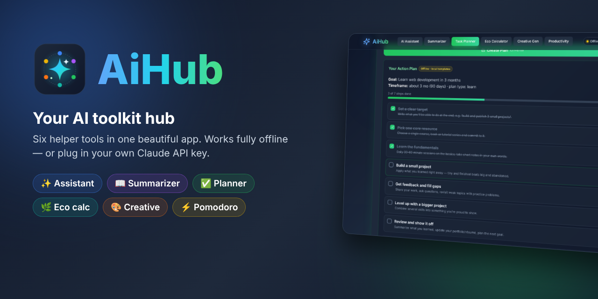

</div>

---

## ✨ Features

| | Tool / feature | What it does |
|---|---|---|
| 💬 | **AI Assistant** | Offline: math (`(3+4)^2`), percentages (`18% of 245`), unit conversions (`72 f to c`), email drafts, brainstorms, how-to plans, pros & cons, comparison tables, text clean-up. With a key: answers anything |
| 📖 | **Summarizer** | Picks out the key sentences of any text (Short / 2–3 sentences / Bullets), plus keywords, word count, reading time and how much shorter it got |
| ✅ | **Task Planner** | Turns a goal like *"Run a 5K in 6 weeks"* into a dated checklist. Tick steps off with a progress bar; **progress is saved** |
| 🌿 | **Eco Calculator** | CO₂ for driving, flying, electricity and water using published average factors. Shows tree-years, phone charges, a comparison with the US daily average, reduction tips, and a **personal footprint log** |
| 🎨 | **Creative Gen** | Stories, poems, haiku, slogans, name ideas and project ideas on any topic. Hit **Remix** for a fresh take |
| ⚡ | **Productivity** | Tips matched to your problem (procrastination, phone distraction, energy, studying…) plus a **Pomodoro timer** with a chime and a daily 🍅 counter |
| 🔑 | **Use my own API key** | Optional. Stored **only in your browser's localStorage**, sent **only to `api.anthropic.com`** (model `claude-haiku-4-5`). Has a test button and clear error messages, and falls back to offline results if a request fails |
| 🏷️ | **Honest labels** | Every result shows a badge: 🟡 *Offline · local templates* or 🟢 *Claude · claude-haiku-4-5* |
| 🔍 | **Command palette** | `Ctrl K` or `/` to jump to any tool, example or action |
| 🕘 | **History** | Your last 12 runs per tool. Tap one to restore it |
| 🔗 | **Share links** | `#planner?q=Launch a small business` opens the tool and runs your input |
| 📋 | **Copy & download** | Copy with a sparkle burst ✦, or save a result as a `.txt` file |
| ⌨️ | **Keyboard friendly** | `1`–`6` switch tools · `Ctrl Enter` run · `E` focus input · `P` Pomodoro · `K` key settings · `?` help |
| 📲 | **Get the app** | Android APK, one-click PWA install, iPhone tips and an offline zip |

## 📸 Screenshots

<table>
<tr>
<td>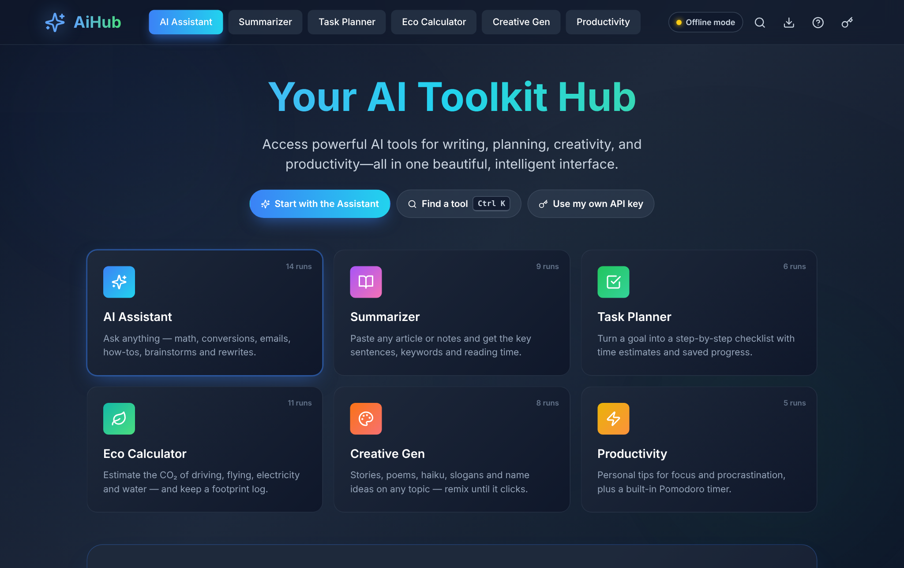<p align="center">🏠 <b>The hub</b>: six tools, usage counters</p></td>
<td>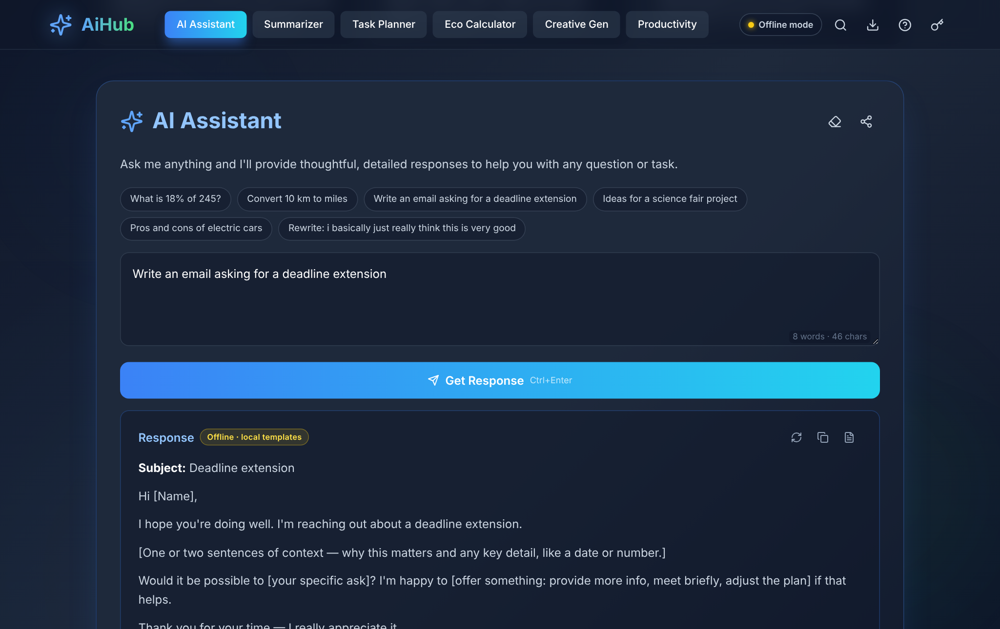<p align="center">💬 <b>AI Assistant</b>: offline email draft</p></td>
</tr>
<tr>
<td>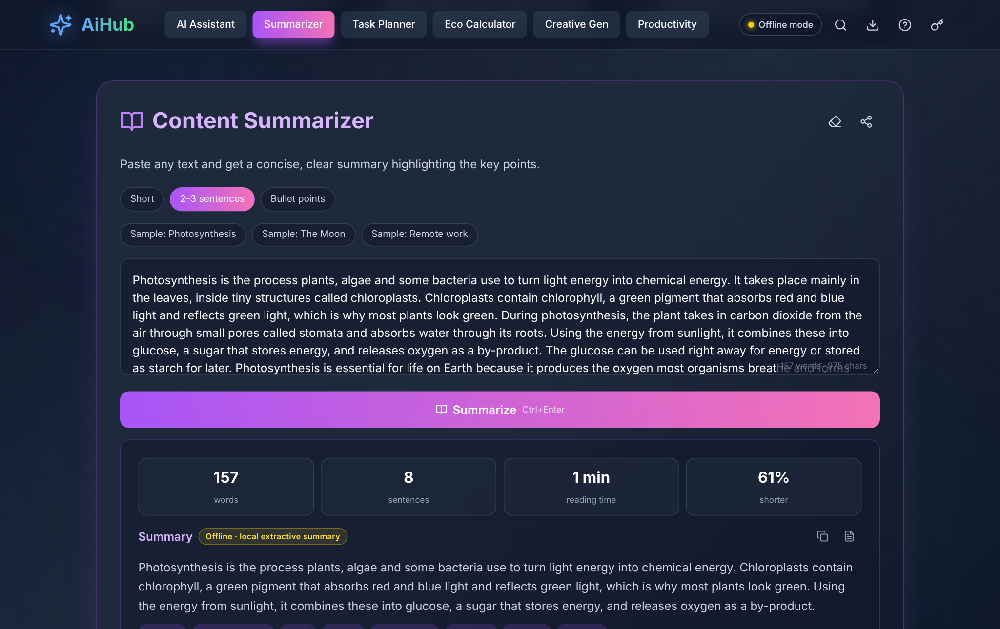<p align="center">📖 <b>Summarizer</b>: stats, keywords, lengths</p></td>
<td>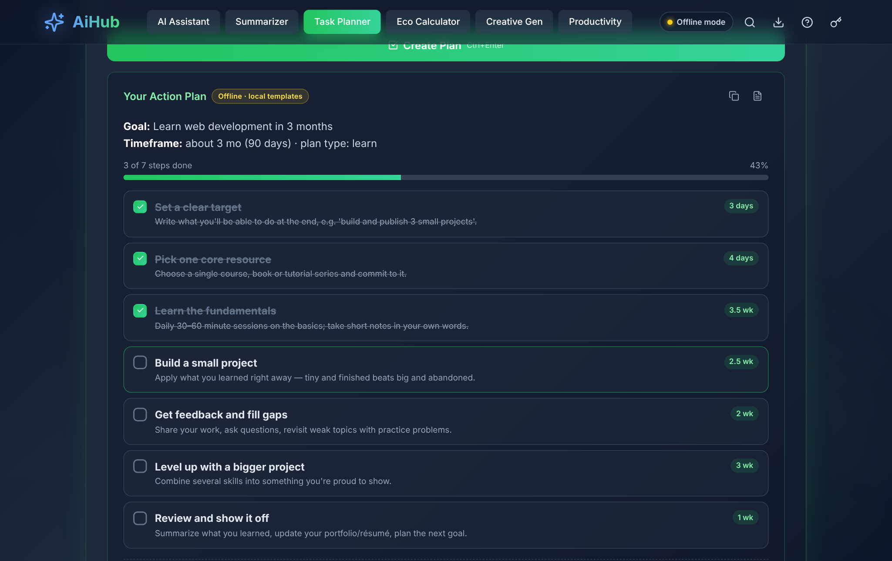<p align="center">✅ <b>Task Planner</b>: checklist with saved progress</p></td>
</tr>
<tr>
<td>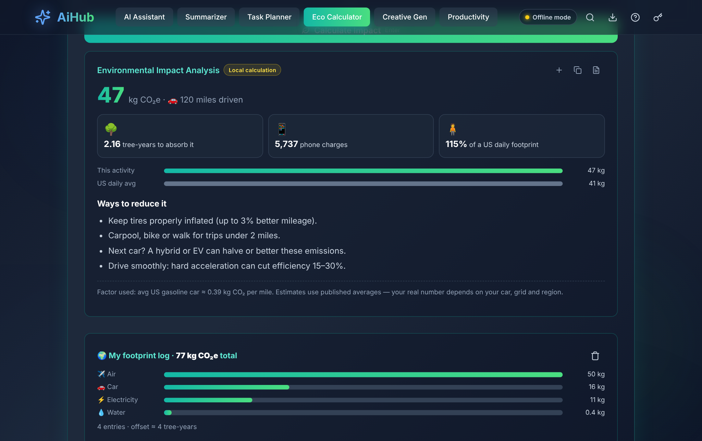<p align="center">🌿 <b>Eco Calculator</b>: CO₂ and comparisons</p></td>
<td>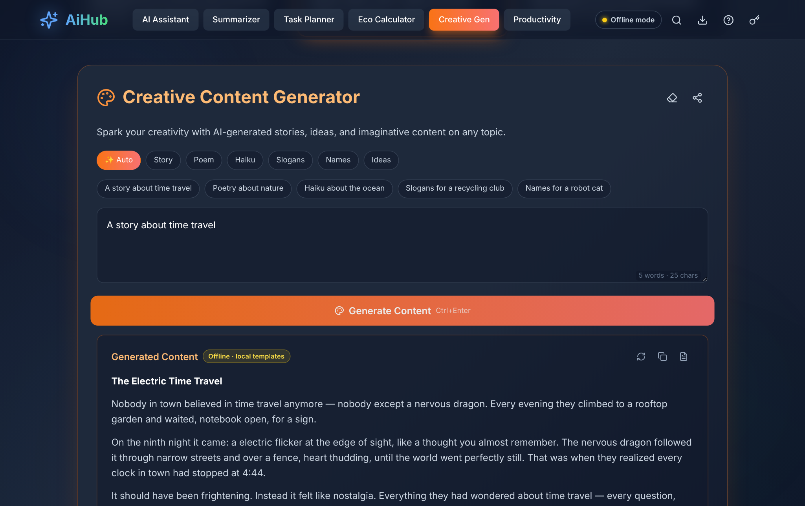<p align="center">🎨 <b>Creative Gen</b>: stories, poems, haiku…</p></td>
</tr>
<tr>
<td>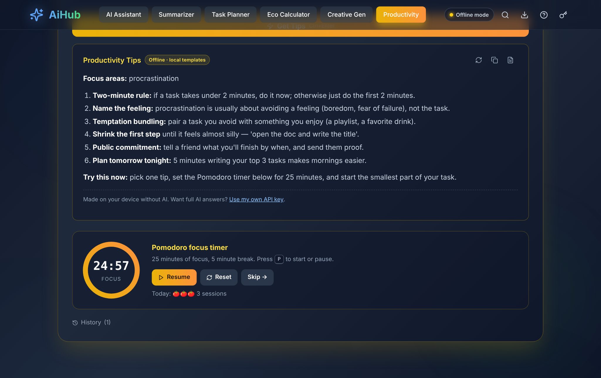<p align="center">⚡ <b>Productivity</b>: tips and Pomodoro timer</p></td>
<td>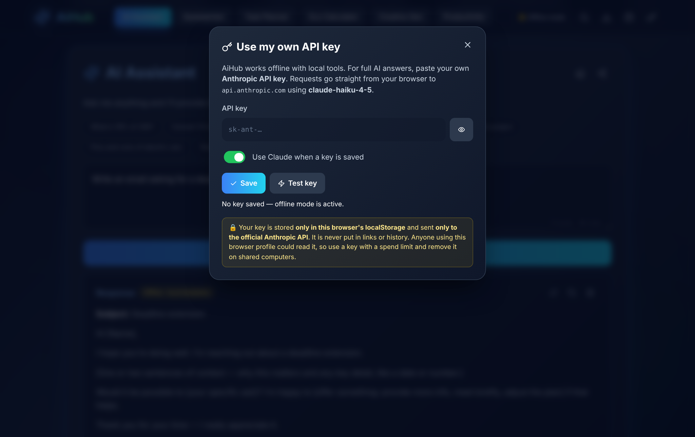<p align="center">🔑 <b>Use my own API key</b>: stays on your device</p></td>
</tr>
<tr>
<td>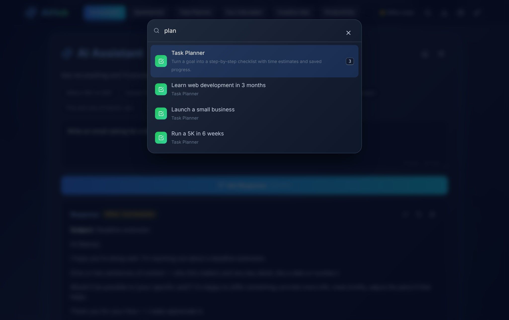<p align="center">🔍 <b>Command palette</b> (<code>Ctrl K</code>)</p></td>
<td>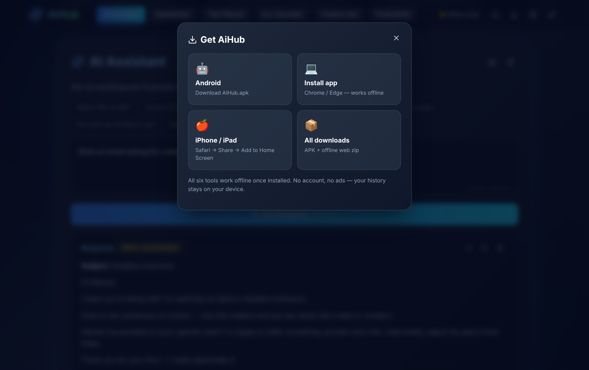<p align="center">📲 <b>Get the app</b></p></td>
</tr>
</table>

<p align="center">
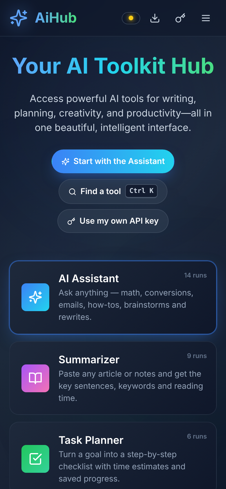
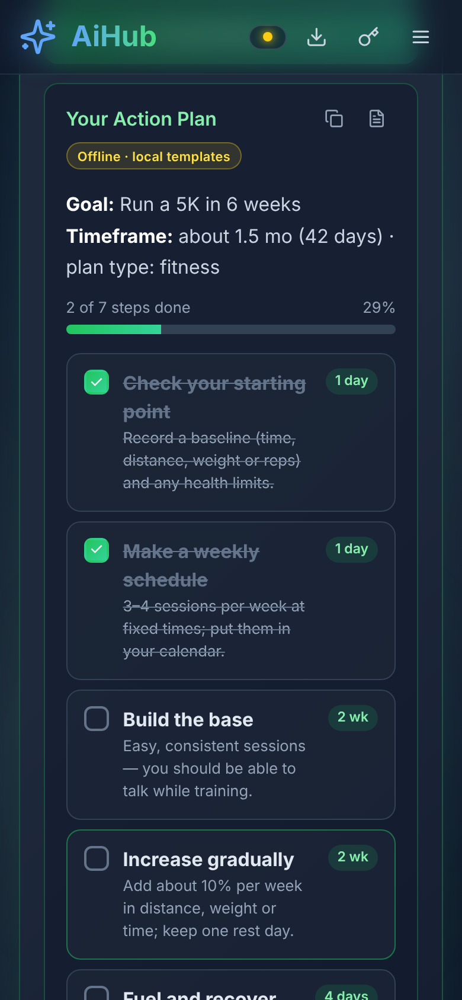
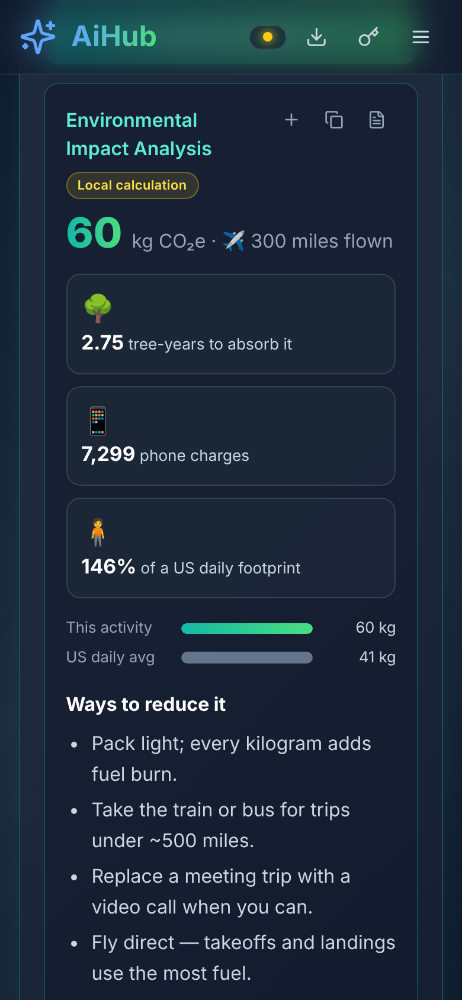
<br><em>📱 Made for phones, with big tap targets and a slide-down menu</em>
</p>

## 📥 Get AiHub

| Platform | How |
|---|---|
| 🌐 **Web** | Open **[jaineil32624.github.io/AiHub](https://jaineil32624.github.io/AiHub/)**. Nothing to install |
| 🤖 **Android** | Download **[AiHub.apk](https://github.com/jaineil32624/AiHub/releases/latest/download/AiHub.apk)** → open it → allow *Install unknown apps* if asked |
| 💻 **Windows / Mac / Chromebook** | Open the website in Chrome or Edge → **⬇ Get the app** → **Install** |
| 🍎 **iPhone / iPad** | Open the website in Safari → **Share** → **Add to Home Screen** |
| 📦 **Offline zip** | Grab **AiHub-web.zip** from [Releases](https://github.com/jaineil32624/AiHub/releases/latest), unzip it and open `index.html` |

> 💡 No account, no ads, no tracking. History, plans and your footprint log stay on your device.

## 🔑 About the API key

AiHub never ships with a key. If you want real AI answers:

1. Create a key at [console.anthropic.com](https://console.anthropic.com/) (setting a spend limit is a good idea).
2. In AiHub, click the **🔑 key icon** → paste the key → **Test key** → **Save**.
3. The header chip turns green: **Claude · own key**. Toggle it off any time to go back to offline mode.

The key lives only in `localStorage` on that browser. It is sent only to `https://api.anthropic.com/v1/messages`, with the `anthropic-dangerous-direct-browser-access: true` header that browser calls require, and it is never put in share links or history. Remove it on shared computers.

## 🛠️ Run it locally

```bash
git clone https://github.com/jaineil32624/AiHub.git
cd AiHub
python3 -m http.server 8000      # then open http://localhost:8000
```

It's a single `index.html` with no build step and no dependencies.

### 🧪 Tests

```bash
pip install playwright && playwright install chromium
python3 -m http.server 8802 &
python3 tests/e2e_test.py        # 38 checks: every tool, shortcuts, API-key mode (mocked), 390px layout
```

## 🗂️ Project structure

```
AiHub/
├── index.html              🧱 the whole app: styles, offline engines, UI, optional Claude client
├── AiToolsWebsite.jsx      ⚛️ the original React component (kept for reference)
├── sw.js                   📴 offline service worker
├── manifest.webmanifest    📲 installable-app manifest
├── icons/                  🖼️ app icons (SVG + PNG + maskable)
├── tests/e2e_test.py       🧪 headless Playwright test
├── docs/screenshots/       📸 images for this README
├── VERSION                 🏷️ bump to publish a new release
└── .github/workflows/
    └── release.yml         🤖 builds the Android APK + publishes a Release
```

## 🚀 Releasing a new version

Bump the number in `VERSION` and push. GitHub Actions then builds the APK and publishes the release:

```bash
echo "1.1.0" > VERSION
git commit -am "Release 1.1.0" && git push
```

---

<div align="center">

Made with 💙, ☕ and a lot of ✨ by **[Jaineil Rana](https://github.com/jaineil32624)**

⭐ *If AiHub helped you get something done, give it a star!* ⭐

</div>
